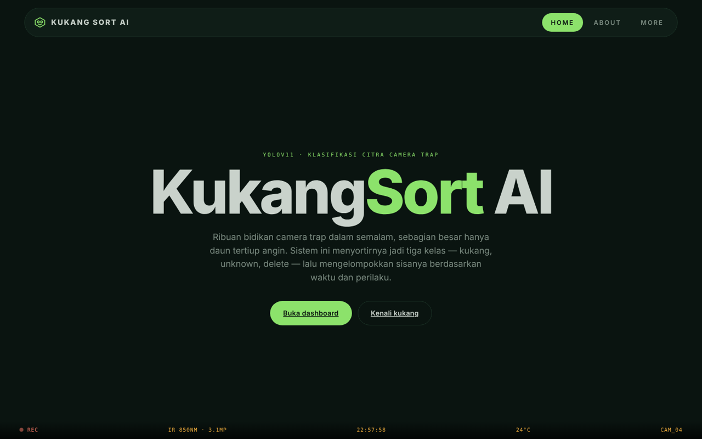
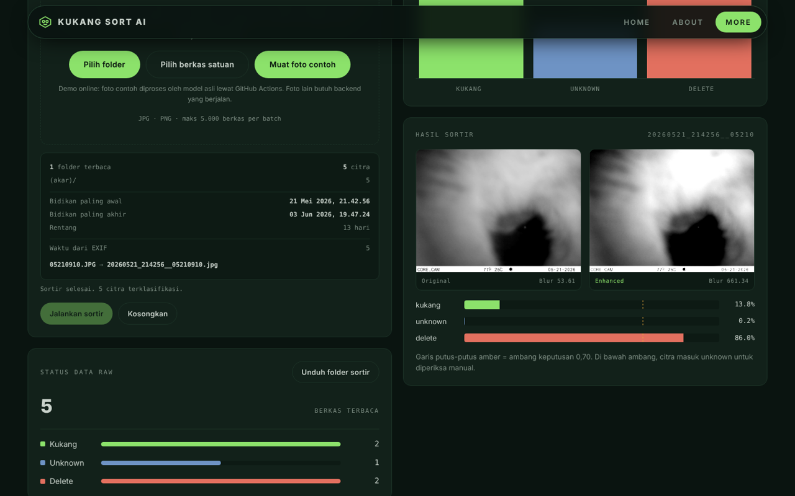
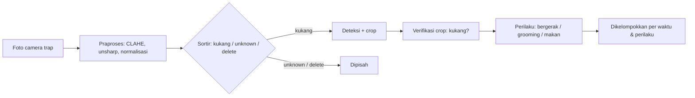

# KukangSort AI

Sortir otomatis foto *camera trap* kukang (slow loris). Ribuan foto dari satu malam kebanyakan cuma daun tertiup angin; sistem ini memilahnya jadi **kukang / unknown / delete**, lalu menebak perilaku kukang (**bergerak / grooming / makan**).

**Demo:** https://rivaldimhr.github.io/kukangsort-ai/ → buka dashboard → klik **"Muat foto contoh"**.




## Tentang demo

Halaman demo jalan di GitHub Pages, yang hanya bisa menyajikan file statis — **backend Python (model YOLO) tidak berjalan di sana**. Supaya hasilnya tetap asli, GitHub Actions menjalankan model sungguhan pada foto contoh di setiap push ke `main`, lalu menyimpan hasilnya ke `demo/results.json`. Jadi:

- Foto contoh → hasil **nyata** dari model (bukan angka acak).
- Foto Anda sendiri → perlu backend berjalan (lihat *Menjalankan*), lalu buka halaman dengan `?api=http://alamat-backend`.

## Alur



Keyakinan di bawah **0,70** atau hasil verifikasi yang bertentangan diberi tanda **perlu review**.

## Model

| File | Tugas | Kelas |
|---|---|---|
| `sortir_best.pt` | Sortir foto | kukang, unknown, delete |
| `verifier_best.pt` | Cek ulang crop | kukang, bukan_kukang |
| `yolo11n.pt` | Deteksi objek (crop) | — |
| `kukang_behaviour_best.pt` | Perilaku (foto utuh) | bergerak, grooming, makan |
| `behaviour_best_crop.pt` | Perilaku (crop) | bergerak, grooming, makan |

Semua YOLO11n-cls (ultralytics 8.3.0), disajikan lewat FastAPI.

## Hasil nyata pada foto contoh (CI)

| Foto | Sortir | Perilaku |
|---|---|---|
| 05210910 | delete (0,86) | — |
| 05210926 | kukang (0,85) | makan (0,998) |
| 05210936 | kukang (0,99), perlu review | makan (0,93) |
| 05210953 | delete (0,92) | — |
| SUNP0468 | unknown (0,79), buram | — |

## Catatan akurasi

- Model perilaku lama: 87,5% pada 24 foto uji. Catatan perubahan menyebut model crop ±95%, tetapi set ujinya belum didokumentasikan.
- Akurasi model sortir **belum dicantumkan** karena belum ada evaluasi terpisah.

Lima foto contoh di atas bukan uji akurasi, hanya contoh perilaku sistem.

## Menjalankan

```bash
cd kukangsort-backend/backend
pip install -r requirements.txt
uvicorn main:app --port 8000
```

Lalu buka `kukangsort-ai.html` di browser (otomatis memakai `localhost:8000`).

Endpoint: `GET /health`, `POST /api/sort`, `POST /api/behavior`.

## Struktur

```
kukangsort-ai.html          # antarmuka
kukangsort-backend/backend/ # FastAPI + model
scripts/build_demo.py       # jalankan model pada foto contoh → site/
.github/workflows/demo.yml  # CI: cek model + deploy demo ke gh-pages
```

## Keterbatasan

- Demo publik hanya untuk foto contoh; foto lain butuh backend.
- Data latih terbatas pada satu lokasi; foto inframerah buram sering masuk *unknown*.
- Angka akurasi perlu dikonfirmasi ulang dengan set uji yang terdokumentasi.
